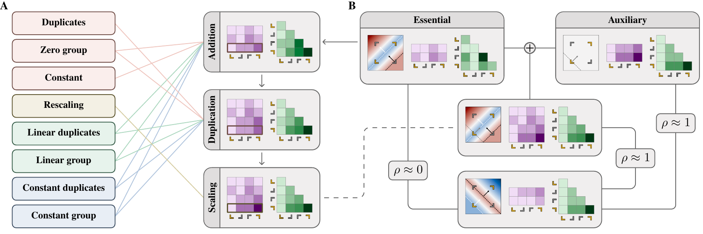

# Parameter symmetries determine representational geometry in overparameterized nonlinear networks

Code and figure sources accompanying our paper "[Parameter symmetries determine representational geometry in overparameterized nonlinear networks](https://arxiv.org/abs/2609.39078)" (NeurIPS 2026).

<p align="center">
  
</p>

## Abstract

Representations are routinely used across machine learning, psychology, and neuroscience to draw inferences about the computations of biological and artificial systems. Such inferences presume a meaningful link between representational geometry and the computation being performed. For artificial neural networks, however, the extent to which function constrains representation remains unclear. One key obstacle is that these networks admit parameter symmetries: changes in parameterization that preserve function exactly while reshaping representational geometry. Here, we show that a broad class of parameter symmetries acts on representations through just three primitive feature transformations: addition, duplication, and scaling. This feature-level characterization yields a closed-form decomposition of representational geometry into essential and auxiliary components, which makes precise how degeneracy in representational geometry can grow with overparameterization even when function is held fixed. Finally, we show that implementation-level selection rules can resolve this degeneracy, yielding identifiable geometries in which features are weighted according to their contributions to the network's function. Together, our results delineate when representations can support inferences about computation, and when they cannot.

## Installation

This project uses [`uv`](https://docs.astral.sh/uv/) for dependency management and requires Python 3.13 or newer. With `uv` installed, clone the repository and sync the pinned environment:

```bash
git clone --branch neurips https://github.com/mrvnthss/symmetries-representational-geometry.git
cd symmetries-representational-geometry
uv sync --locked
```

This creates a virtual environment and installs the `symmetries` package together with the dependencies pinned in `uv.lock`. Linux environments include CUDA 13 JAX packages; macOS uses CPU JAX. The paper's XOR sweep used the CPU backend, as shown below.

## Reproducing the figures

The [marimo](https://marimo.io/) notebooks under `notebooks/figures/` generate the main-figure components and the complete appendix figures. Launch them from `notebooks/` so their imports, style sheets, shared cache, and output paths resolve correctly. The `--directory notebooks` flag handles this; notebook paths are then relative to `notebooks/`. Open a notebook interactively:

```bash
uv run --locked --directory notebooks marimo edit figures/main/dissociation/components.py
```

or run it as a read-only app:

```bash
uv run --locked --directory notebooks marimo run figures/main/primitives/components.py
```

| Paper figure | Notebook, relative to `notebooks/`                  | Output                                                          |
| ------------ | --------------------------------------------------- | --------------------------------------------------------------- |
| Figure 1     | `figures/main/dissociation/components.py`           | XOR networks and representational similarity matrices           |
| Figure 1     | `figures/main/dissociation/parameter_symmetries.py` | Parameter-symmetry illustrations                                |
| Figure 2     | `figures/main/primitives/components.py`             | Primitive feature transformations and representational geometry |
| Figure B.1   | `figures/appendix/opposite_orientations.py`         | Oppositely oriented ReLU parameterizations                      |
| Figure C.1   | `figures/appendix/activations_even_linear.py`       | Even-linear activation decompositions                           |
| Figure C.2   | `figures/appendix/activations_constant_odd.py`      | Constant-odd activation decompositions                          |
| Figure C.3   | `figures/appendix/activations_remaining.py`         | Remaining activation functions                                  |
| Figure G.1   | `figures/appendix/xor_sweep_geometry.py`            | Boundary geometry of the converged XOR networks                 |
| Figure G.2   | `figures/appendix/xor_sweep_clusters.py`            | Representatives of the six solution clusters                    |
| Figure G.3   | `figures/appendix/xor_solutions.py`                 | The six analytical XOR ReLU solutions                           |

The appendix notebooks export PDFs to `figures/appendix/submission/` with the conference fonts and to `figures/appendix/preprint/` with the preprint fonts. The fonts and their licenses are documented in [notebooks/figures/fonts/README.md](notebooks/figures/fonts/README.md).

Figures 1 and 2 combine notebook-generated SVG components with layouts and LaTeX labels assembled manually in Inkscape. The editable sources are [dissociation.svg](figures/main/dissociation/dissociation.svg) and [primitives.svg](figures/main/primitives/primitives.svg); these contain the LaTeX commands for the labels. The finished figures, with labels rendered in the paper's fonts, are included as [dissociation.pdf](figures/main/dissociation/dissociation.pdf) and [primitives.pdf](figures/main/primitives/primitives.pdf). Rerunning the notebooks regenerates the components; rebuilding the final figures requires the manual assembly step.

The notebook `figures/templates/hidden_unit_components.py` generates activation-curve assets under `figures/templates/generated/`. The symmetry illustrations use the manually prepared neuron template `figures/templates/manual/hidden_unit.svg`.

## Illustrative XOR experiment

Appendix G describes the training sweep used to identify the six ReLU solution types illustrated in Figure 1. Open its analysis notebook with:

```bash
JAX_PLATFORMS=cpu uv run --locked --directory notebooks marimo edit experiments/xor_clustering.py
```

The shared configuration in [notebooks/experiments/sweeps.py](notebooks/experiments/sweeps.py) uses 1,000 initializations, two hidden ReLU units, full-batch Adam with learning rate 0.1, 10 million optimization steps, a convergence threshold of `1e-12`, and master seed 0. Loss histories are sampled every 10,000 steps. The reported sweep produced 296 converged networks and took approximately nine minutes on an Apple M4 CPU; runtime depends on the machine.

The analysis notebook and the notebooks for Figures G.1 and G.2 share a disk cache under `notebooks/__marimo__/cache/`, created on first use and excluded from Git. A fresh clone therefore computes the sweep on its first run; subsequent runs reuse it. Delete this cache directory to force a fresh sweep. The main-figure notebooks and the analytical-solution notebook use closed-form networks and do not require training.

## Repository structure

```
src/symmetries/       # core library (import symmetries)
  activations.py      # JAX activation-function registry
  geometry2d.py       # build networks from geometric parameters
  mlp.py              # minimal Equinox MLP
  training.py         # JIT training loop + multi-seed sweeps
  rsa.py              # representational similarity analysis
  distances.py        # distance / similarity measures
  clustering.py       # hierarchical clustering of solutions
  xor.py              # XOR task + analytical solutions
  plotting.py         # 2D network visualization
  svg.py, colors.py   # figure-generation helpers
notebooks/            # figure notebooks, cached XOR sweep and analysis, utilities
figures/              # figure components and rendered outputs
tests/                # unit tests
```

## Citation

```bibtex
@inproceedings{theiss2026parameter,
	address   = {Paris, France},
	title     = {Parameter symmetries determine representational geometry in overparameterized nonlinear networks},
	volume    = {39},
	url       = {https://arxiv.org/abs/2609.39078},
	booktitle = {Advances in {Neural} {Information} {Processing} {Systems}},
	publisher = {Curran Associates, Inc.},
	author    = {Theiss, Marvin and Braun, Lukas and Saxe, Andrew M. and Grant, Erin},
	year      = {2026},
	note      = {To appear},
}
```

## License

The code is released under the [MIT License](LICENSE). Bundled fonts retain their own licenses, documented [here](notebooks/figures/fonts/README.md).
